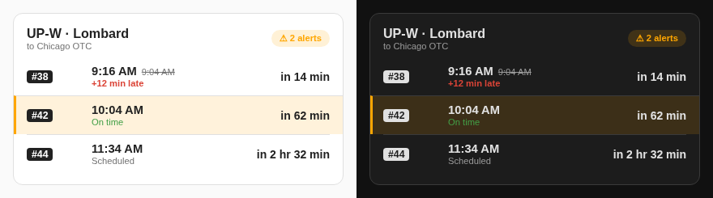
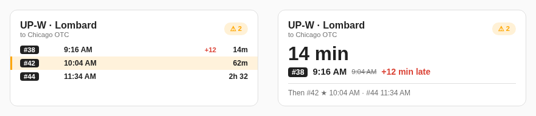
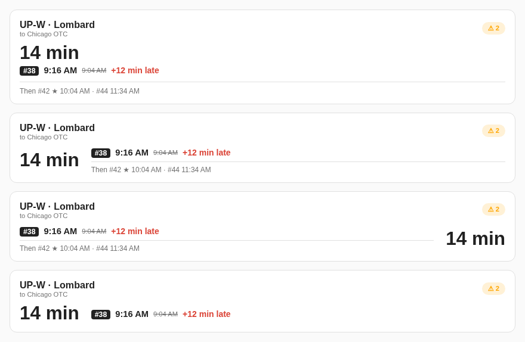
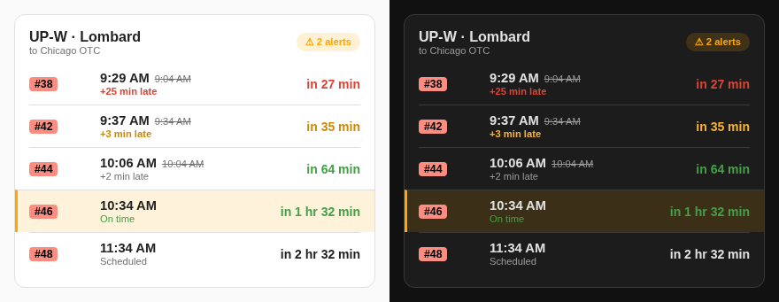
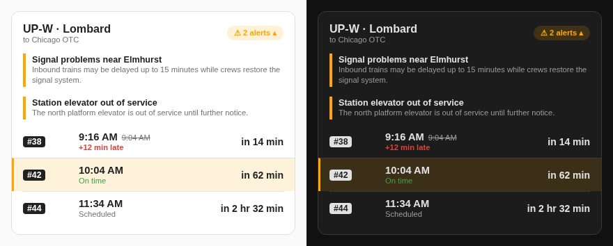
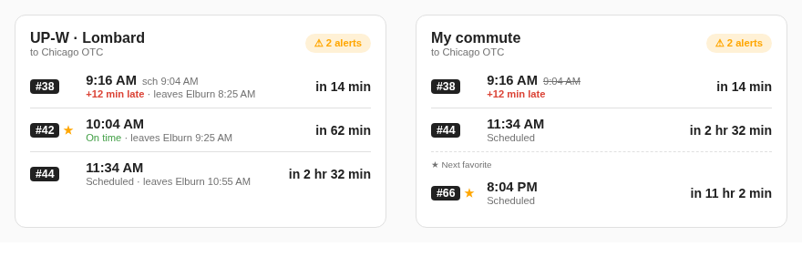

# Metra Train Tracker for Home Assistant

See upcoming [Metra](https://metra.com) trains, delays and service alerts for your
stations in Home Assistant, with a dashboard card included.

This is an unofficial community project. It isn't affiliated with or endorsed by Metra.



_Screenshots use sample data._

## What you get

For each station you add:

| Entity | Description |
| --- | --- |
| Next arrival | When the next train is expected, including any delay |
| Next train | The next train's number |
| Next train delay | Minutes late, or negative if early |
| Service alert | On when the line has a service alert, with the text as an attribute |
| Next favorite arrival, train and delay | The same details for your next favorite train, if the station has favorites |

You also get the **Metra Train Tracker** dashboard card, with no separate install.

## Requirements

- Home Assistant 2026.10 or newer
- A Metra GTFS API key, which you can request from
  [Metra's developer page](https://metra.com/developers)

## Install

### HACS

1. In HACS, open the ⋮ menu and choose **Custom repositories**.
2. Add `https://github.com/adamjeffery/metra-ha` with the type **Integration**.
3. Download **Metra Train Tracker**, then restart Home Assistant.

### Manual

Copy `custom_components/metra_train_tracker` into the `custom_components` folder next to your
`configuration.yaml`, then restart Home Assistant.

## Set up

1. Go to **Settings → Devices & services → Add integration**, choose **Metra Train Tracker** and
   enter your API key.
2. On the Metra Train Tracker integration page, choose **Add station**, then pick:
   - **Line** and **Station**
   - **Direction**: inbound, outbound or both
   - **Trains to show**: 1 to 10
   - **Alert terms to ignore**: hides alerts containing these words, such as
     `construction`
   - **Favorite trains** (optional): the trains you usually catch
3. Repeat for each station and direction you want.

To change a station later, use the ⋮ menu next to it on the integration page.

## Add the card

Edit a dashboard, add a card and search for **Metra Train Tracker**. You can also add it
with YAML:

```yaml
type: custom:metra-train-tracker-card
entity: sensor.up_w_lombard_inbound_next_arrival
time_format: 12h
```

| Option | Default | Choices |
| --- | --- | --- |
| `entity` | Required | The station's **Next arrival** sensor |
| `layout` | `list` | `list`, `compact`, or `next_train` for one large countdown |
| `next_train_time` | `above` | Where the `next_train` countdown goes: `above`, `left` or `right`. Left and right use less height on wide cards |
| `show_following` | `true` | Shows the `next_train` layout's **Then** line. Turn it off to save height |
| `time_display` | `expected` | `expected` crosses out the original time when a train is late. Also `scheduled` or `both` |
| `time_format` | `12h` | `12h` (9:04 AM), `24h` (09:04) or `raw` (09:04:00) |
| `countdown` | `minutes` | `minutes`, `auto` for the last 30 minutes only, or `off` |
| `countdown_colors` | `false` | Colors the countdown and delay: green when on time or under 3 minutes late, orange from 3 minutes late, red when significantly delayed. Trains with no live data stay uncolored |
| `significant_delay_minutes` | `20` | Minutes late before a train turns red |
| `line_color_badges` | `false` | Shows train numbers on each line's color. The colors come from Metra's published schedule data |
| `alerts` | `summary` | `summary` is a chip you tap to open. Also `full` or `hidden` |
| `favorites` | `highlight` | `highlight`, `mark` for a star, or `only` to list nothing else |
| `pin_favorite` | `false` | Always show the next favorite, even if it's further out than the list |
| `max_trains` | All | Up to the station's **Trains to show** setting |
| `title` | Line and station | Any text |
| `show_header` | `true` | Hides the title. Alerts still show |
| `show_origin` | `false` | Adds where each train starts, like `leaves Elburn 4:15 AM` |

Trains with live data show **On time** or how late they are. Trains without any yet show
**Scheduled**.

### Examples

The `compact` and `next_train` layouts:



The `next_train` layout with `next_train_time` set to `above`, `left` and `right`, then `left`
with `show_following` off:



`countdown_colors` and `line_color_badges`, with trains 25, 3 and 2 minutes late, then on time, then
with no live data yet. Line colors come from Metra's published schedule data:



Service alerts with the summary chip tapped open:



On the left, `show_origin`, `time_display: both` and `favorites: mark`. On the right, a custom
`title` with `pin_favorite`:



## Example automation

Get a notification when one of your favorite trains is running late:

```yaml
alias: Train running late
triggers:
  - trigger: numeric_state
    entity_id: sensor.up_w_lombard_inbound_next_favorite_delay
    above: 5
actions:
  - action: notify.notify
    data:
      message: >-
        Train {{ states('sensor.up_w_lombard_inbound_next_favorite_train') }} is
        {{ trigger.to_state.state }} minutes late.
```

## How it works

- **Schedule:** downloaded from Metra at startup and daily at 5 AM Central. A copy is
  kept in `.storage`, so restarts don't download it again. If a download fails, the
  previous schedule stays in use and the download is retried hourly.
- **Realtime data:** checked every minute. Metra is only called every 2 minutes for
  delays and positions, and every 5 minutes for alerts. A copy up to an hour old is used
  during an outage, after which the entities become unavailable.
- **Upcoming trains:** only the rest of the current service day is shown, so after the
  last train the list is empty until the next day's service begins.
- **Favorite trains:** identified by train number, so they survive schedule updates. The
  favorite sensors look at all of today's remaining trains. The card only marks favorites
  among the trains it shows, unless you turn on `pin_favorite`.

## Troubleshooting

| Problem | What to try |
| --- | --- |
| A repair asks you to re-authenticate | Metra rejected your API key. Enter a new one. |
| Entities are unavailable | Metra's realtime feed has been unreachable for over an hour. Check the logs. |
| The card says `Stale: data from…` | The data is over 5 minutes old, usually because Home Assistant can't reach Metra. |
| Custom element doesn't exist in a browser | Hard-refresh the page (Ctrl+Shift+R). |
| Custom element doesn't exist in the Companion app | Closing the app isn't enough. Use **Reset frontend cache** in the app's settings, then reopen it. |

## Development

```bash
pip install -r requirements_test.txt
pytest
```
